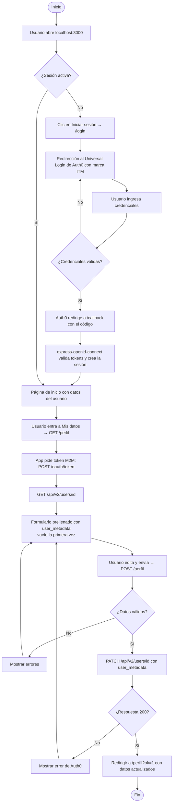

# Taller Auth0 – Aplicaciones y servicios web (ITM)

Aplicación en **Node.js + Express** que:

1. Autentica usuarios con **Auth0** usando la librería oficial `express-openid-connect`.
2. Usa el **Universal Login** personalizado con la imagen del ITM.
3. Muestra un formulario (tipo de documento, número, dirección, teléfono) **prellenado desde `user_metadata`**.
4. Guarda los cambios en `user_metadata` consumiendo la **Auth0 Management API v2** (`PATCH /api/v2/users/{id}`).

Todo corre localmente en `http://localhost:3000`.

---

## Estructura

```
auth0-itm/
├── app.js                       # Servidor Express, rutas y login con Auth0
├── services/auth0Management.js  # Token M2M + GET/PATCH a la Management API
├── views/
│   ├── index.ejs                # Inicio (datos del usuario logueado)
│   ├── perfil.ejs               # Formulario de datos personales
│   └── partials/                # Encabezado y pie
├── public/styles.css
├── .env.example                 # Plantilla de variables de entorno
└── package.json
```

---

## Guía paso a paso

### Paso 0 – Requisitos
- Node.js 18 o superior (`node -v`)
- Cuenta gratuita en https://auth0.com
- Git y una cuenta de GitHub

### Paso 1 – Crear la aplicación de login en Auth0 (Punto 1)
1. En el dashboard: **Applications → Applications → Create Application**.
2. Nombre: `Taller ITM`. Tipo: **Regular Web Applications** → Create.
3. En la pestaña **Settings** copia el **Domain** y el **Client ID**.
4. Más abajo, en *Application URIs*:
   - **Allowed Callback URLs:** `http://localhost:3000/callback`
   - **Allowed Logout URLs:** `http://localhost:3000`
   - **Allowed Web Origins:** `http://localhost:3000`
5. **Save Changes**.

### Paso 2 – Crear la aplicación Machine to Machine (para el Punto 4)
La Management API no se puede llamar con el login del usuario; necesita un token propio.
1. **Applications → Create Application** → nombre `Taller ITM API` → tipo **Machine to Machine**.
2. Autoriza la API **Auth0 Management API**.
3. Marca los permisos (scopes): **`read:users`** y **`update:users`** → Authorize.
4. En *Settings* copia el **Client ID** y el **Client Secret** de esta app.

### Paso 3 – Configurar el proyecto
```bash
npm install
cp .env.example .env        # en Windows: copy .env.example .env
```
Edita `.env` con tus valores:
```
AUTH0_DOMAIN=dev-xxxx.us.auth0.com
AUTH0_CLIENT_ID=<Client ID de la app Regular Web>
AUTH0_M2M_CLIENT_ID=<Client ID de la app M2M>
AUTH0_M2M_CLIENT_SECRET=<Client Secret de la app M2M>
SECRET=<cadena aleatoria>
```
Para generar `SECRET`:
```bash
node -e "console.log(require('crypto').randomBytes(32).toString('hex'))"
```

### Paso 4 – Probar el login localmente
```bash
npm start
```
Abre `http://localhost:3000` → **Iniciar sesión** → te lleva al formulario de Auth0. Regístrate con un correo o con Google.

📸 **Evidencia Punto 1:** captura del formulario de logueo y de la página de inicio con tu nombre después de entrar.

### Paso 5 – Personalizar el Universal Login (Punto 2)
1. Dashboard: **Branding → Universal Login**.
2. En **Customization Options** (o *Customize* en el editor de temas):
   - **Logo URL:** una URL pública (https) del logo del ITM. Puedes usar la del sitio itm.edu.co (clic derecho sobre el logo → *Copiar dirección de imagen*) o subirlo a un sitio como Imgur.
   - **Primary color:** `#4b2a7b` (morado ITM).
   - **Page background:** el mismo morado o una **imagen de fondo** del campus (en *Themes → Page Background → Background image URL*).
3. Guarda y usa el botón **Try** o vuelve a iniciar sesión desde tu app.


### Paso 6 – Formulario de datos (Punto 3)
Ya logueado, entra a **Mis datos** (`/perfil`).
- La ruta `GET /perfil` llama a `GET /api/v2/users/{id}` y lee `user_metadata`.
- La primera vez los campos salen **vacíos** porque `user_metadata` es `{}`.


### Paso 7 – Guardar con la Management API (Punto 4)
Llena los campos y pulsa **Guardar en Auth0**. La app:
1. Obtiene un token con `POST https://{dominio}/oauth/token` (`grant_type=client_credentials`).
2. Envía `PATCH https://{dominio}/api/v2/users/{id}` con `{ "user_metadata": { ... } }`.
3. Redirige a `/perfil`, que vuelve a leer de Auth0 y muestra los campos **prellenados**.

Compruébalo también en el dashboard: **User Management → Users → tu usuario → Details → user_metadata**.


### Paso 8 – GitHub (Punto 5)
```bash
git init
git add .
git commit -m "Taller Auth0 ITM"
git branch -M main
git remote add origin https://github.com/<tu-usuario>/auth0-itm.git
git push -u origin main
```
RECOMENDACION : > `.env` está en `.gitignore`: **nunca** subas tus secretos.


---

## Diagrama de flujo



---

## Bibliografía
- Auth0. *Express.js: Add Login to Your Web Application*. https://auth0.com/docs/quickstart/webapp/express
- Auth0. *Management API v2 – Users: Update a user*. https://auth0.com/docs/api/management/v2/users/patch-users-by-id
- Auth0. *Get Management API Access Tokens for Production*. https://auth0.com/docs/secure/tokens/access-tokens/management-api-access-tokens/get-management-api-access-tokens-for-production
- Auth0. *Customize Universal Login*. https://auth0.com/docs/customize/login-pages/universal-login
- Auth0. *Understand How Metadata Works in User Profiles*. https://auth0.com/docs/manage-users/user-accounts/metadata
- express-openid-connect (GitHub). https://github.com/auth0/express-openid-connect
